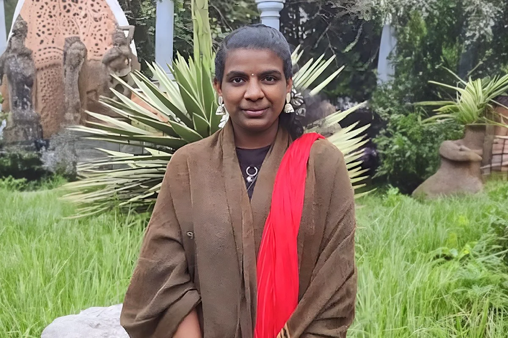

#### Divya thought she may not be able to progress past her first year of study due to lack of funds to pay her diploma fees, but thankfully she was introduced to Nia and has now become the first graduate in her family.

My name’s R.Divya Lakshmi and I’m in the final year of a Health Assistant Diploma run by IMA Paramedical. Whilst I was in my first year of study I feared I would have to discontinue my study because I didn’t have enough funds to pay the fees.

It was then that our CMO Senthil Kumar Sir introduced me to Nia. I had never heard about Nia’s work before and it was very timely as I thought that was the end of my studies. Happily, Nia now pays my educational fees which has made my family very happy and enabled me to become the first graduate in my family!

Nia is the only reason I could complete my studies and make my family proud.

I have developed my knowledge of English in the Nia Spoken English Class and I am now, in turn, looking to support other Nia students. I give hearty thanks to Nia for helping me to reach the next level in my life and supporting me to complete my diploma in Health Assistant Study.
