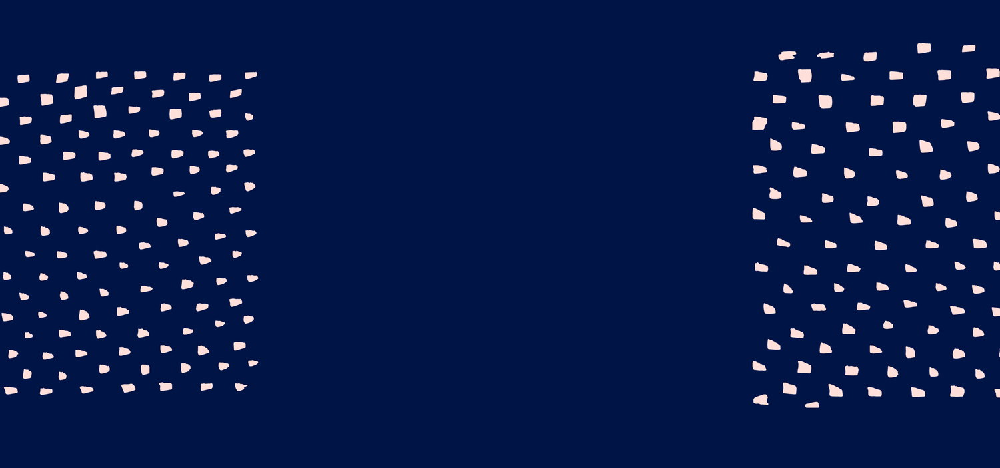
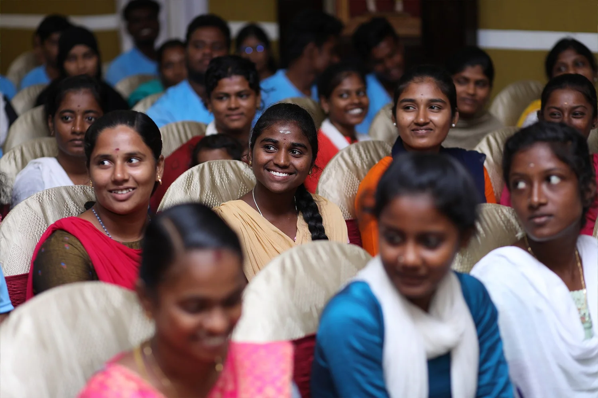
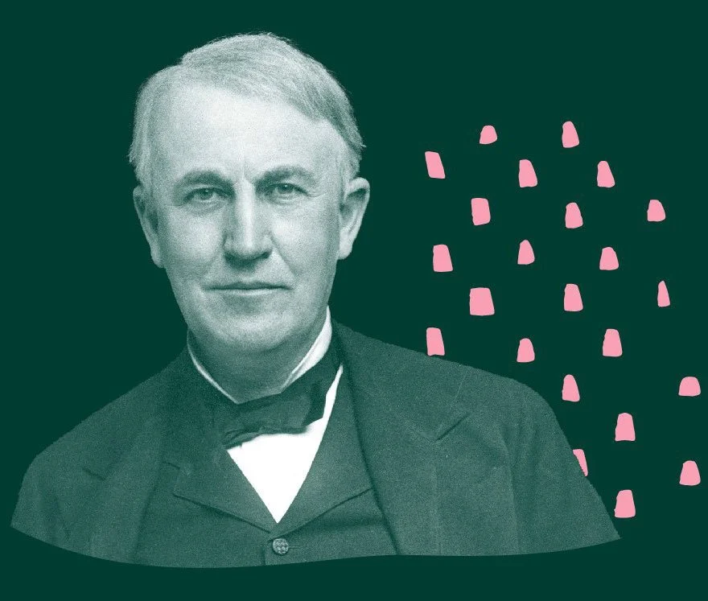
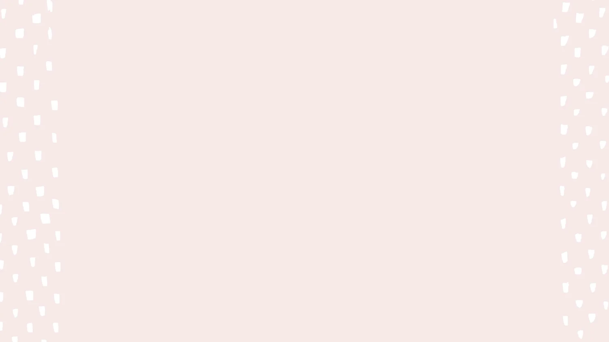
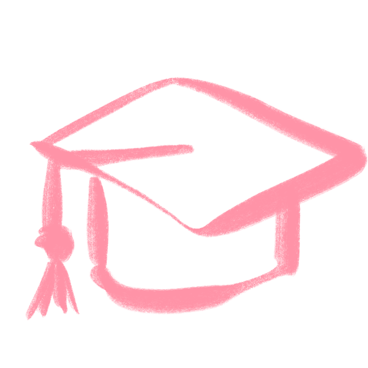
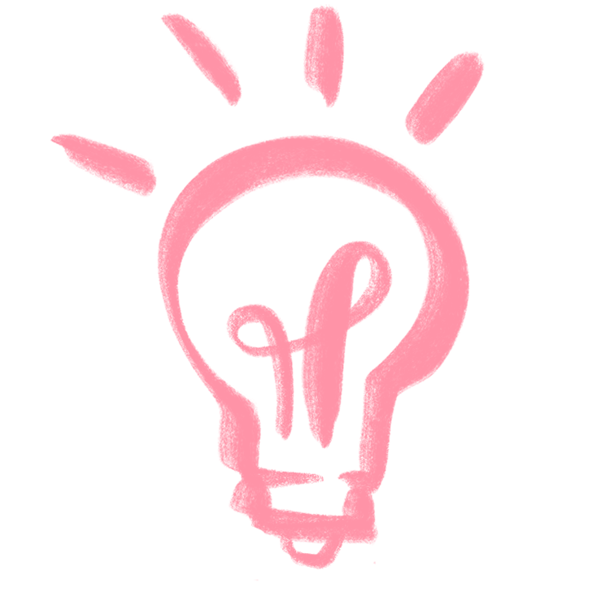
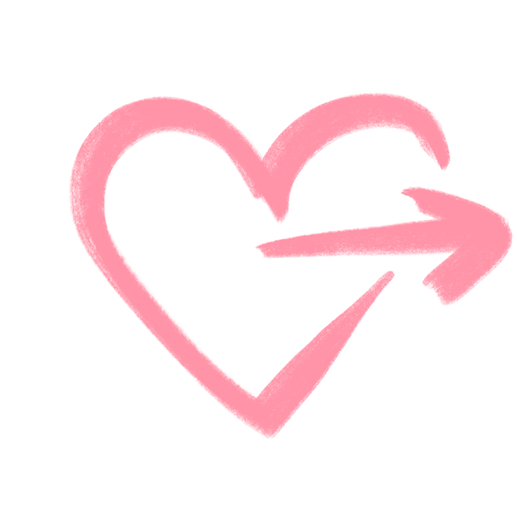

<!-- section 1: theme=dark -->

# Who we are

---

<!-- section 2: theme=white -->

Unlocking human potential and harnessing it to make the world a better place is a noble endeavor that everyone can rally behind. Today, the *power of choice* and *equal opportunity* is a distant dream for many, especially for girls in developing countries.

In 2001, it all started as a humble experiment in a small village in Tamil Nadu, one of the large states in southern India. The idea was simple. What if girls from financially underprivileged backgrounds were provided with the financial support to pursue their higher education? The results were inspiring. One of the girls even seized upon this opportunity and went on to win the Tamil Nadu Governor’s Gold Medal for academic excellence. She eventually became a lecturer, teaching English at a local community college.

Thus Nia was born, and in 2004 it was formally incorporated, energized by the early success and driven by the motivation to pass on the gift of choice to more young girls from deserving backgrounds. In addition to enhancing their lives, empowered and educated women also played a critical role in overall social development. Some examples include improvement in overall women’s health, children’s health, children’s education, position of women in families and communities.

Nia’s vision is to empower girls with the power of choice and restore their right to dream without constraints and reach out to opportunities without limits.

Nia aspires to accomplish this vision by raising funds to financially support deserving girls across the world and mentor them to pursue their dreams.

---

<!-- section 3: theme=n/a -->

# The Power of choice

---

<!-- section 4: theme=dark -->

## "If we all did the things we are capable of, we would astound ourselves."

—Thomas Edison

---

<!-- section 5: theme=white -->

## Our team

<!-- People come from _data/team.yml (team:). The layout renders them in phase 3. -->


---

<!-- section 6: theme=n/a -->

## Board members

<!-- People come from _data/team.yml (board:). -->


---

<!-- section 7: theme=dark -->

## Our Programs

#### Empower through education

#### Inspire via community

#### Pay it forward

[Donate](/donate/){: .button}
