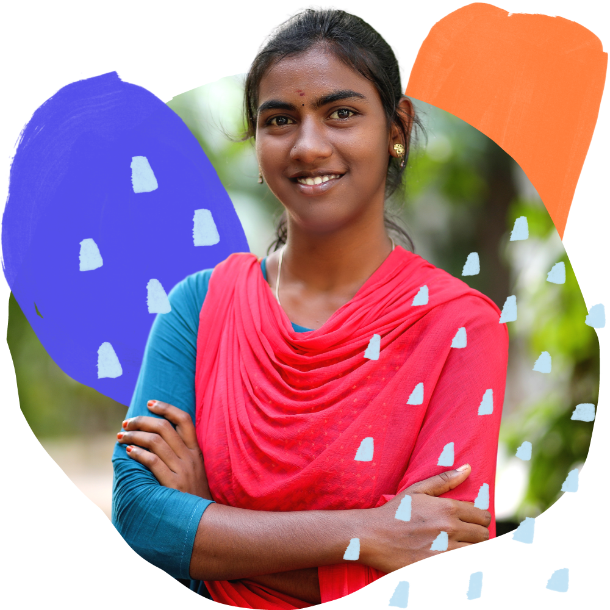
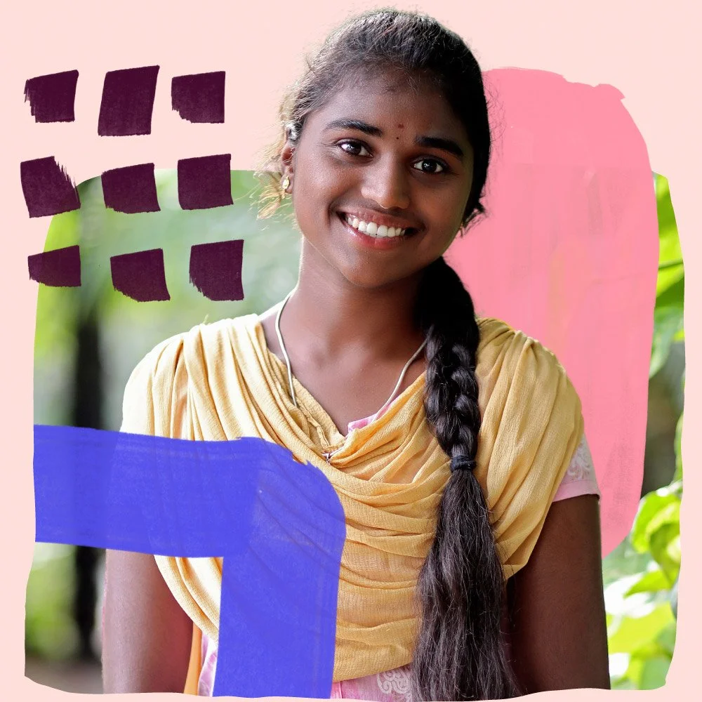
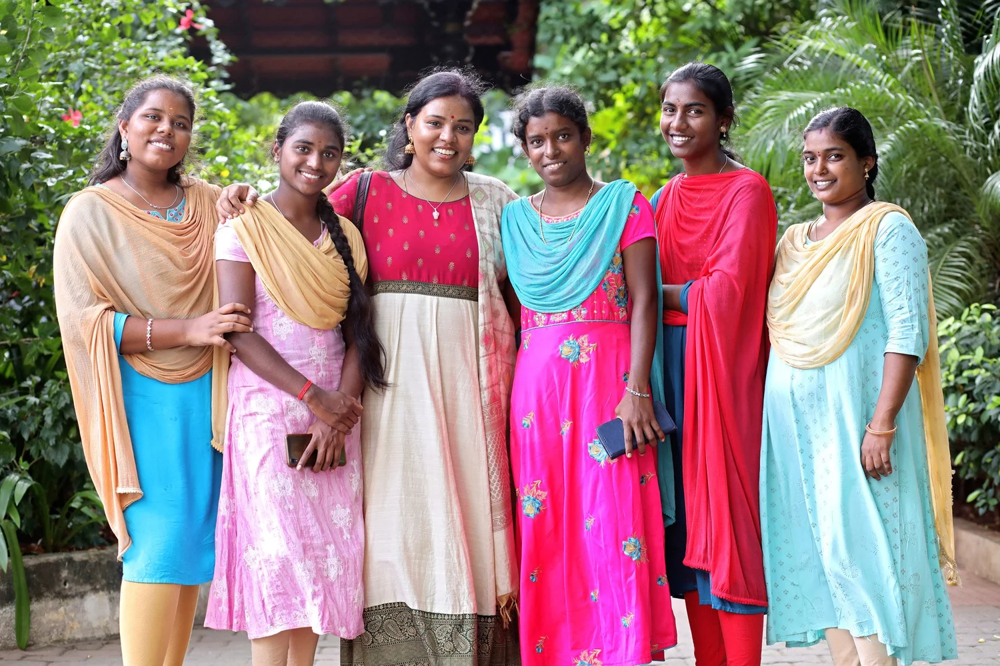
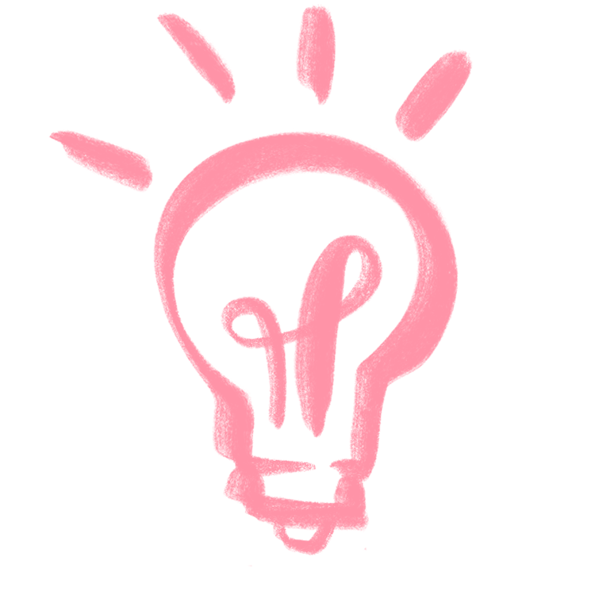
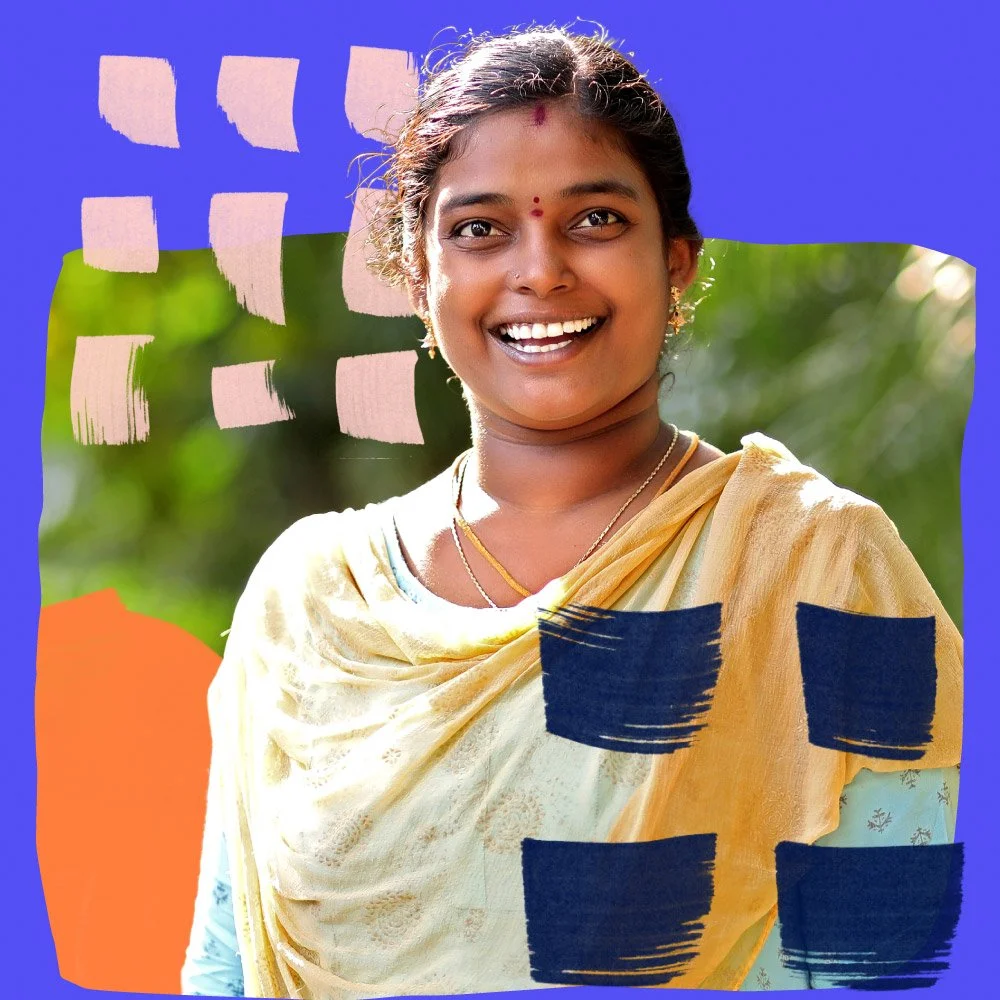

<!-- section 1: theme=dark -->

## Empowering young females through education and choice

With education underpinning every girl's future, Nia endeavours to educate and provide aspiring girls with the power of choice, the right to opportunity, and help to realise their potential.

[Learn more](/about/){: .button}

---

<!-- section 2: theme=bright -->

### **Power of choice**

We don't have to accept the world as it is; we can do our part to seek life as it should be. A life of our choice.

### **Right to Opportunity**

We have an obligation to be inspired by the sense of possibility and pursue our dreams.

### **Realise potential**

Advance and extend development; continue to encourage opportunity and equality for oneself and others.

Nia delivers on this vision by raising funds to financially support deserving girls across the world and mentor them to pursue their dreams.

---

<!-- section 3: theme=dark-bold -->

## Nia in numbers

## 1,000+

girls are part of the Nia family

## 15

villages across South India

## 45

study programs changing lives

## 20+

years empowering young women

---

<!-- section 4: theme=n/a -->

# Making a difference

---

<!-- section 5: theme=dark -->

## Our programs

#### Empower through education

#### Inspire via Community

#### Pay it forward

[Donate](/donate/){: .button}

---

<!-- section 6: theme=white -->

## Student’s stories

Take a limitation and turn it into an opportunity. Take an opportunity and turn it into an adventure. Dream big!

[Get inspired](/stories/){: .button}

---

<!-- section 7: theme=n/a -->

## Join our community

[Donate](/donate/){: .button}

[Instagram](https://www.instagram.com/niathepowerofchoice/) · [LinkedIn](https://www.linkedin.com/company/nia-the-power-of-choice)
