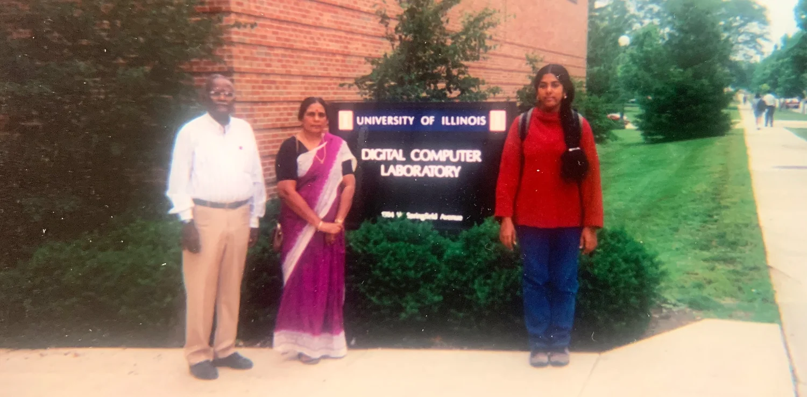
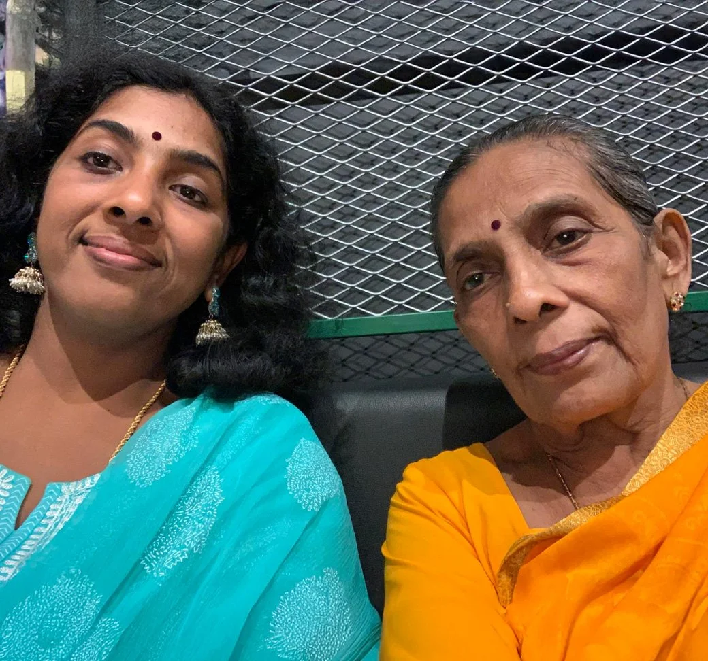

<section class="band navy" markdown="1">

#### NIA INSPIRE

# Sumathi Radhakrishnan
Memorial Award

</section>

<section class="band blush" markdown="1">

A scholarship in honour of **Ms. Sumathi Radhakrishnan** – a woman whose values of kindness, equality, and belief in girls’ education continue to inspire change. Through **Nia Inspire**, this award supports girls in Tamil Nadu in pursuing an education of their choice and building a life shaped by opportunity and power of choice.

### A tribute that creates opportunity

This scholarship has been instituted by [Shobana Radhakrishnan](https://www.linkedin.com/in/shobanaradhakrishnan/) in memory of her mother, Ms. Sumathi Radhakrishnan. Shobana, who grew up in Chennai and went on to build a distinguished career in technology leadership, shares a deep belief in the power of education and its ability to transform lives. Her association with Nia and faith in its grassroots mission led her to create this scholarship to help uplift girls through education.

At the heart of this award is a daughter’s tribute to a mother whose life, values, and quiet strength left a lasting impact – not only on her own family, but on the many lives she touched.

### Remembering Sumathi Radhakrishnan

Born in Thoothukudi and raised in Tamil Nadu, **Ms. Sumathi Radhakrishnan** believed deeply in the importance of education, especially for girls. Though her own education was curtailed in her teenage years due to the social norms of the time, she remained a strong advocate for learning, independence, and advancement for the girl child.

As a mother of two, she played an active role in encouraging educational achievement and professional ambition. She was known for her kindness, generosity, and willingness to help others in both small and meaningful ways. Her life reflected the values she passed on: treat everyone equally, extend a helping hand, and believe in education as a path to freedom and accomplishment.

</section>

<section class="band navy" markdown="1">

## What Sets Us Apart

#### Why this scholarship matters

Many girls in India continue to face financial, social, and cultural barriers that interrupt or limit their education. For students with talent and aspiration, the absence of support can become the difference between a dream deferred and a dream realised.

The **Sumathi Radhakrishnan Memorial Award** exists to support Nia students who want to pursue their dreams through education – giving deserving girls the chance to shape their futures by offering the power of choice through education.

#### What this MEMORIAL award stands for

This scholarship reflects the spirit of **Nia Inspire**: **to honour meaningful lives and values by opening doors for the next generation of girls.**

It is not only a remembrance – it is an investment in possibility, confidence, and a more independent future for young women. This is how one life can continue to inspire many others. The award is intended to support girls facing barriers to education and help them pursue learning and life goals of their choice.

#### Create a legacy of opportunity

Through **Nia Inspire**, individuals and families can honour someone dear to them by supporting a girl’s education and future.

If you would like to institute a scholarship in memory or celebration of a loved one, we invite you to join us in creating pathways of hope, choice, and opportunity.

**Sponsor a scholarship through Nia Inspire. Help a girl pursue the future she deserves.**

[Get in touch](mailto:hello@niapower.org?subject=Nia%20Inspire){: .button}

</section>
